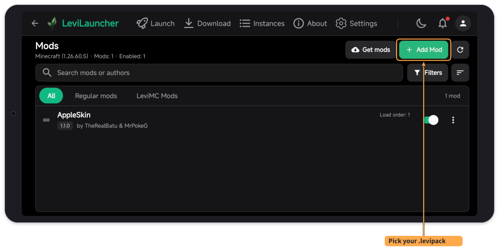

# Your first Android native mod

At the end of this tutorial you have a native mod for Minecraft Bedrock on Android: a C++ library built from the official template, packed as a `.levipack`, imported into LeviLauncher on your phone, and writing a line of your own to the Android log when the game starts. The mod also has a setting that you change from LeviLauncher.

It takes about an hour the first time, most of it installing the Android SDK.

::: info Android, not LeviLamina
Android native mods are loaded by the [Android version of LeviLauncher](https://levimc.org/LeviLauncher/guide/mods-integrations?platform=android) through the Preloader SDK ([LiteLDev/preloader-android](https://github.com/LiteLDev/preloader-android)), not by LeviLamina. They use their own `pl::` API. The shape of a mod (`load()`, `enable()`, `disable()`, `getSelf()`) is the same as in [Your first LeviLamina mod](first-levilamina-mod.md).
:::

## What you need

- A PC with Windows, Linux or macOS, and these tools:
  - [Android Studio](https://developer.android.com/studio), or only its command-line tools, for the Android SDK and NDK;
  - [CMake](https://cmake.org/download/) 3.22 or newer and [Ninja](https://github.com/ninja-build/ninja/releases);
  - [PowerShell 7](https://learn.microsoft.com/powershell/scripting/install/installing-powershell) (Windows PowerShell works too on Windows);
  - a C++ compiler for the PC itself: Visual Studio with **Desktop development with C++** on Windows, or GCC or Clang on Linux and macOS. The build runs a small program on the PC that writes the default config of the mod;
  - [Git](https://git-scm.com).
- An ARM64 Android phone (Android 9 or later) with Minecraft from Google Play and LeviLauncher for Android: see [Play with mods on Android](../play/play-with-mods-android.md).
- Optional: [Android platform tools](https://developer.android.com/tools/releases/platform-tools) (`adb`) and USB debugging on the phone, to read the log.
- Basic C++.

## 1. Install the SDK and the NDK

1. In Android Studio, open **Settings** → **Languages & Frameworks** → **Android SDK**. On **SDK Platforms**, tick **Android 9.0 (API 28)**. On **SDK Tools**, tick **Show Package Details** and, under **NDK (Side by side)**, `28.2.13676358`. Apply.
2. Note the **Android SDK Location** at the top of that page, such as `C:\Users\<you>\AppData\Local\Android\Sdk`.
3. In a new terminal, check the other tools:

   ```powershell
   cmake --version
   ninja --version
   ```

You should see a CMake version of 3.22 or later, a Ninja version, and the folder `ndk\28.2.13676358` in the SDK location.

## 2. Create your repository from the template

1. Open [levilauncher-android-mod-template](https://github.com/QYCottage/levilauncher-android-mod-template) and press **Use this template** → **Create a new repository**, for example `my-android-mod`.
2. Clone it:

   ```powershell
   git clone https://github.com/<you>/my-android-mod
   cd my-android-mod
   ```

3. You should see `CMakeLists.txt`, `manifest.json.in`, `scripts\package.ps1` and `src\mod\` with `MyMod.cpp`, `MyMod.h`, `Config.h` and `Config.cpp`.

## 3. Name your mod

Open `CMakeLists.txt`. Near the top, a few settings describe your mod; they fill in its `manifest.json`. Change them:

```cmake
set(MOD_ID "my_android_mod" CACHE STRING "LeviLauncher mod package directory name")
set(MOD_NAME "My Android Mod" CACHE STRING "LeviLauncher mod display name")
set(MOD_AUTHOR "<you>" CACHE STRING "LeviLauncher mod author")
set(MOD_VERSION "0.1.0" CACHE STRING "LeviLauncher mod version")
set(MOD_LIBRARY_NAME "my_android_mod" CACHE STRING "Native library name without lib prefix or .so suffix")
set(MOD_MINECRAFT_VERSIONS "[\"1.26.*\"]" CACHE STRING "Raw JSON array for manifest minecraft_versions")
```

- `MOD_ID` is the folder of the mod on the phone. Keep it stable after your first release: LeviLauncher uses it for paths, the Mod Menu and the saved settings of users.
- `MOD_NAME` is the name LeviLauncher shows, and the tag of your lines in the Android log.
- `MOD_MINECRAFT_VERSIONS` lists the game versions the mod runs on; `*` matches the rest of a version. An empty list `[]` means every version. Make sure it matches the Minecraft on your phone.

The template's C++ namespace and class are `clange_me` and `ClangeMeMod`. You can rename them later; this tutorial keeps them.

## 4. Write your first line

The template already has a typed config: the struct `ModConfig` in `src\mod\Config.h` is saved as `config/config.json` of the mod, and its `message` is written to the log when the mod is enabled. Change the default message:

```cpp
struct ModConfig {
    int version = 1;
    bool enabled = true;
    std::string message = "Hello from my first Android mod!";
};
```

Open `src\mod\MyMod.cpp` to see where it is used. The lifecycle is:

1. `load()` runs when the mod is loaded. The template creates the data and config folders and loads the config here.
2. `enable()` runs before the game starts. It writes `Config message: <message>` with `getSelf().getLogger().info(...)`.
3. `disable()` runs when the game closes; `unload()` at the final cleanup.

`PL_REGISTER_MOD` at the end of `src\main.cpp` registers the one long-lived instance of the mod.

## 5. Build the .levipack

Set the SDK location and run the packaging script for 64-bit ARM:

::: code-group

```powershell [Windows]
$env:ANDROID_HOME = "C:/Users/<you>/AppData/Local/Android/Sdk"
./scripts/package.ps1 -Abi arm64-v8a
```

```shell [Linux and macOS]
export ANDROID_HOME="$HOME/Android/Sdk"     # macOS: $HOME/Library/Android/sdk
pwsh ./scripts/package.ps1 -Abi arm64-v8a
```

:::

On Windows, run it in **Developer PowerShell for VS**, so that CMake finds the PC compiler. The first build downloads the Preloader SDK and a few libraries.

You should end with the file `build-arm64-v8a\my_android_mod-0.1.0-arm64-v8a.levipack`. A `.levipack` is a ZIP file holding the folder `my_android_mod\` with `manifest.json`, `libmy_android_mod.so` and `config\`.

::: tip Let GitHub build it
The template has a workflow in `.github\workflows\build.yml`. After you push, the **Actions** tab of your repository builds the `.levipack` files and offers them as an artifact; a tag `v*` also attaches them to a release.
:::

## 6. Import it into LeviLauncher

1. Copy the `.levipack` to the **Download** folder of your phone, by USB or any way you like.
2. Open LeviLauncher. On the **Launch** page, tap **Manage** on the **Mods** card: the **Mods** page of the current instance opens.
3. Tap **Add Mod** and choose your `.levipack` in the file picker. You should see "Successfully processed 1 mod files". (You can also open the `.levipack` from a file manager and choose LeviLauncher.)

   

4. You should see **My Android Mod** in the list of mods, with version `0.1.0` and its switch on.

New to LeviLauncher on Android? [Play with mods on Android](../play/play-with-mods-android.md) goes through it step by step.

## 7. Check that it runs

1. Launch the game from LeviLauncher.
2. With the phone connected by USB, read the Android log on the PC:

   ::: code-group

   ```powershell [Windows]
   adb logcat | Select-String "My Android Mod"
   ```

   ```shell [Linux and macOS]
   adb logcat | grep "My Android Mod"
   ```

   :::

   You should see a line with `Config message: Hello from my first Android mod!`.

3. Back in LeviLauncher, open the details of your mod. It now has a config: change **Message** to something else and save. Launch the game again; the log shows the new message.

No `adb`? Step 3 still works: the config exists only because your mod ran its `load()` and saved it.

## What you have now

- A repository with an Android native mod that builds a `.levipack` on your PC and on GitHub.
- The mod installed in LeviLauncher, writing to the Android log, with a setting users can change.

## Next steps

- The lifecycle in detail: [Mod API](https://levimc.org/LeviLamina/developer_guides/android/api/mod/).
- More settings, with titles, descriptions and limits: [Config API](https://levimc.org/LeviLamina/developer_guides/android/api/config/).
- Buttons and switches in the game: [Mod Menu API](https://levimc.org/LeviLamina/developer_guides/android/api/mod_menu/). Touch and keys: [Input API](https://levimc.org/LeviLamina/developer_guides/android/api/input/).
- Change how the game behaves: [Hook API](https://levimc.org/LeviLamina/developer_guides/android/api/hook/), [Signature API](https://levimc.org/LeviLamina/developer_guides/android/api/signature/) and [Patch API](https://levimc.org/LeviLamina/developer_guides/android/api/patch/).
- The headers and macros of the SDK: [SDK headers and macros](https://levimc.org/LeviLamina/developer_guides/android/api/types_and_macros/).
- A complete example with a Mod Menu, buttons and images: `examples/full-cpp-mod` in [LiteLDev/LeviLauncher-Android](https://github.com/LiteLDev/LeviLauncher-Android).
- Native mods in LeviLauncher, from the player's side: [Mods & Integrations](https://levimc.org/LeviLauncher/guide/mods-integrations?platform=android).
