# Play with mods on Windows

At the end of this tutorial you play Minecraft Bedrock Edition on Windows with LeviLamina and a mod, in an instance of LeviLauncher that keeps its worlds and settings apart from your normal game. LeviLauncher installs the game version, LeviLamina and the mods for you: you do not need `lip` or anything else.

## What you need

- Windows 10 or Windows 11, 64-bit.
- Minecraft Bedrock Edition, bought on the Microsoft account you sign in with, and installed from the Microsoft Store at least once on this PC. LeviLauncher manages your game; it does not replace the license.
- An internet connection.

## 1. Install LeviLauncher

1. Open the [latest release of LeviLauncher](https://github.com/LiteLDev/LeviLauncher/releases/latest) and download `LeviLauncher-amd64-installer.exe`. If GitHub is slow where you are, use the [Lanzou mirror](https://levimc.lanzoue.com/b016ke39hc) with the password `levi`.
2. Run the installer and finish the setup wizard. If it asks to install WebView2 or another component, let it continue.
3. Start LeviLauncher. You should see its window, with a column of icons at the left: **Launch**, **Download**, **Instances**, **About** and **Settings** (point at an icon to see its name). The first time, it opens on the **First Launch Setup**.

## 2. Go through the first launch

1. In the **First Launch Setup**, the **Base Root** under **Content Paths** is where LeviLauncher keeps your instances. Keep it on a drive with a few GB free: to change it, press **Browse…**, choose a folder and press **Apply**. **Language** sets the language of LeviLauncher.

   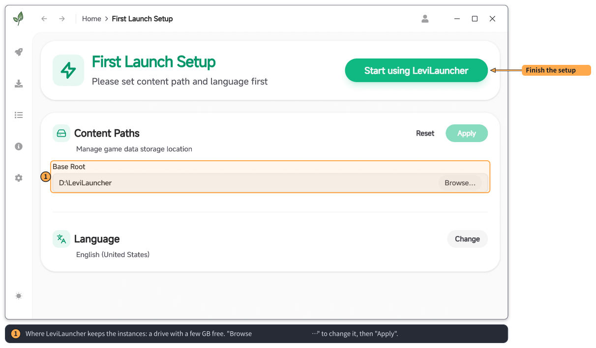

2. Press **Start using LeviLauncher**.
3. LeviLauncher shows its **LeviLauncher License Agreement**. Read it and press **Agree and Continue** once it can be pressed.
4. LeviLauncher asks **Help improve LeviLauncher?**: whether it may send usage statistics (Google Analytics). Choose **Allow and Enable** or **Not Now**; you can change it later in **Settings**.

You are done with this step when you see the **Launch** page. Its big button says **Download Minecraft**, since there is no instance yet.

## 3. Install a game version with LeviLamina

1. Open **Download** in the sidebar.
2. You should see the GDK versions of Minecraft's normal releases: **GDK** (the package type) and **Release** (under **Types**) are already chosen. LeviLamina can be installed automatically only into supported GDK versions.
3. Find the newest version whose **Loader** column shows LeviLamina, and press its **Download**. The newest versions of the game often come out before LeviLamina supports them, so it is not always the first row.

   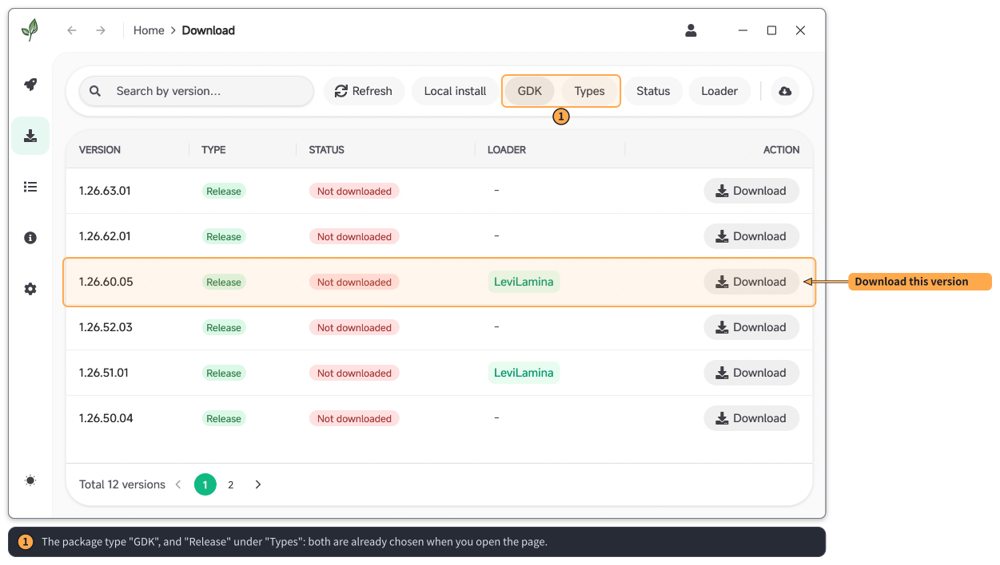

4. In **Select Download Mirror**, LeviLauncher tests the mirrors and selects the fastest. Press **Download from Selected Mirror**.

   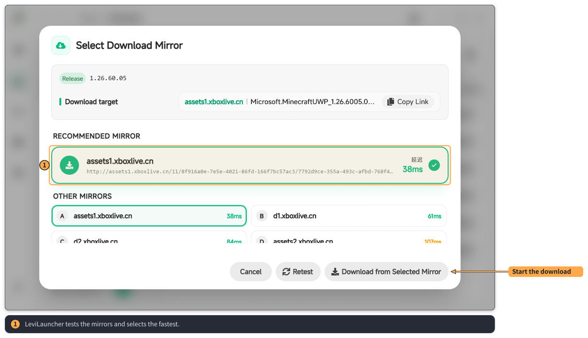

5. Wait for the download, a few GB. When it is done, you should see **Download complete**. Press **Install now**. (Later, the row of the version says **Downloaded**, and its **Install** button does the same.)

   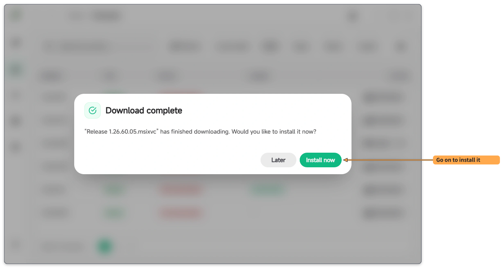

6. On the **Install Instance** page:
   - Give the instance a name under **Instance Name**, such as `Survival`.
   - Keep **Install LeviLamina** on, with the newest **LeviLamina Version**.
   - Keep **Instance isolation** on, so that this instance keeps its worlds, settings and caches in its own folder.

   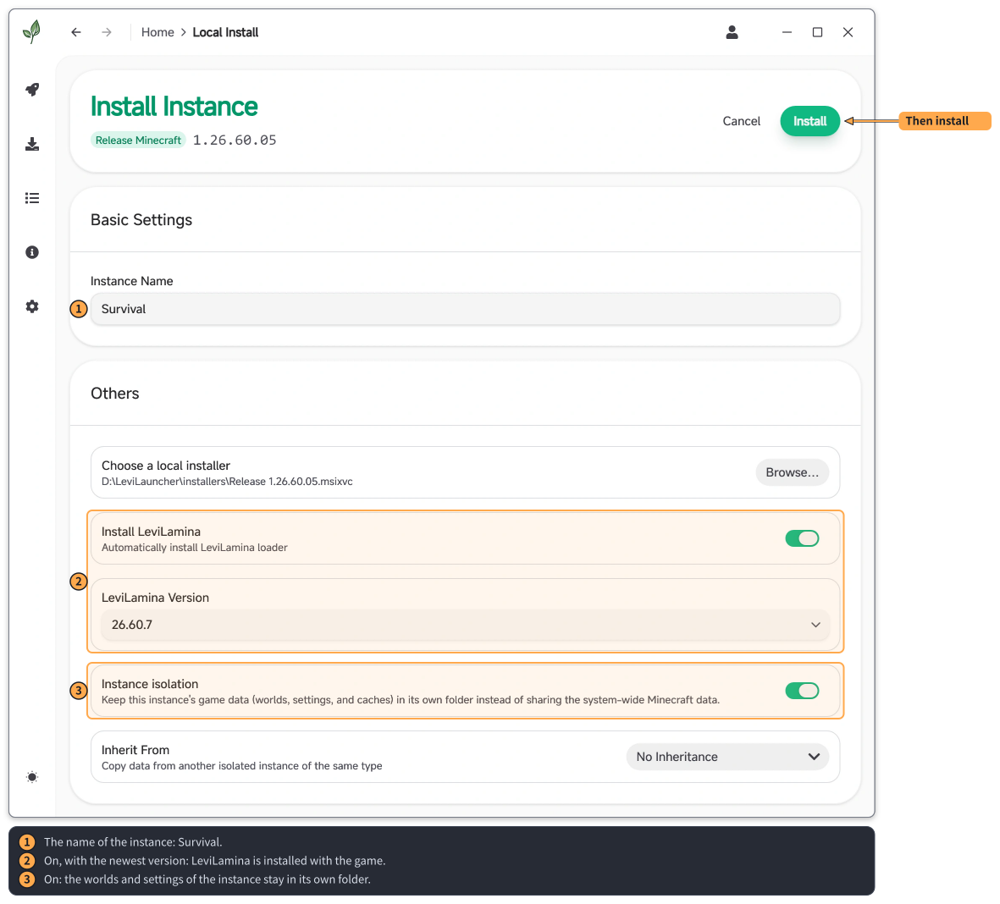

7. Press **Install** at the top of the page, and wait. You should see **Install Complete** and "Installation completed successfully." Press **Select and go to launch**.

If the page has no **Install LeviLamina**, LeviLamina does not support that version: go back to **Download** and pick a version whose **Loader** column shows LeviLamina.

## 4. Launch the game

1. On the **Launch** page, the **Current Instance** should be the instance you just installed, with a LeviLamina badge next to **Minecraft**. If it is not, choose it in the instance picker.

   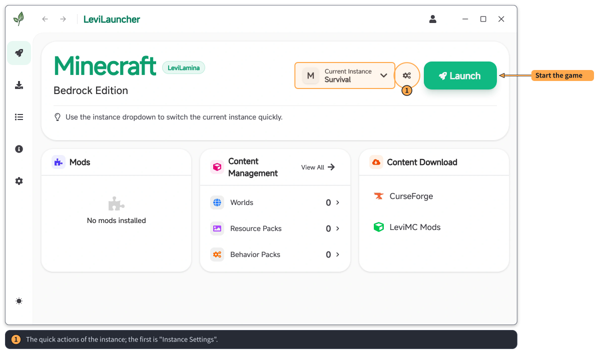

2. Press **Launch**.
3. If something the game needs is missing, LeviLauncher says so instead: **GameInput Component Missing**, **Microsoft Gaming Services Missing** or **Visual C++ Runtime Missing**. Press **Install Now** (for Gaming Services, **Open Store to Install**), follow the installer, and press **Launch** again.

   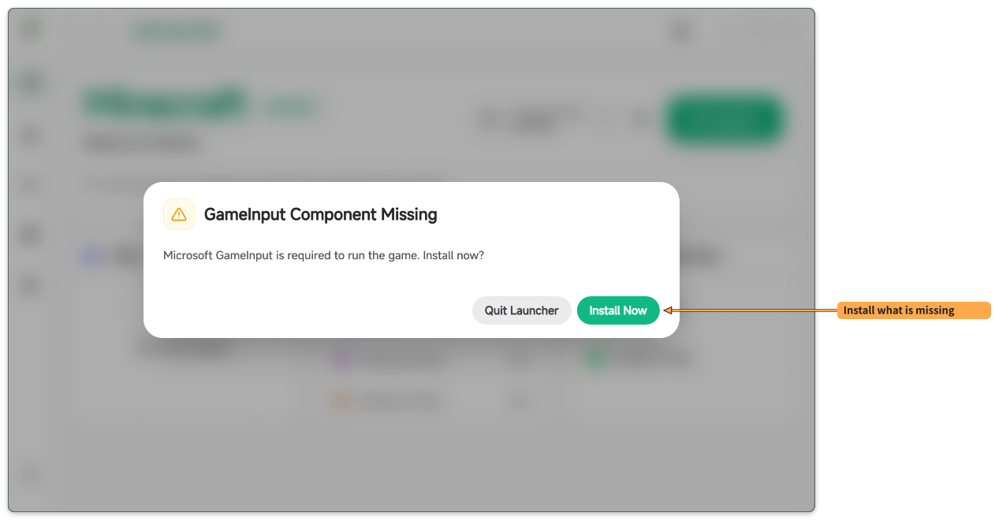

4. Minecraft starts. Close it again once you have seen the title screen: the next step adds a mod.

If LeviLauncher says "This account does not own this version.", the Microsoft account it uses has not bought Minecraft. Press the person icon at the top right (**Sign in with Microsoft**, or **Switch account** when an account is signed in), sign in with the account that bought the game, and launch again.

This first launch without mods tells you that the instance itself works. If something goes wrong later, you know it is the mod.

## 5. Install a mod

1. On the **Launch** page, the **Content Download** card leads to **LeviMC Mods**. Open it. It lists the mods of [LeviMC Mods](https://levimc.org/mods/) that have a build for the game client on Windows, for the LeviLamina of your instance.
2. Type `LeviOptimize` in **Search mods…**, and open LeviOptimize.

   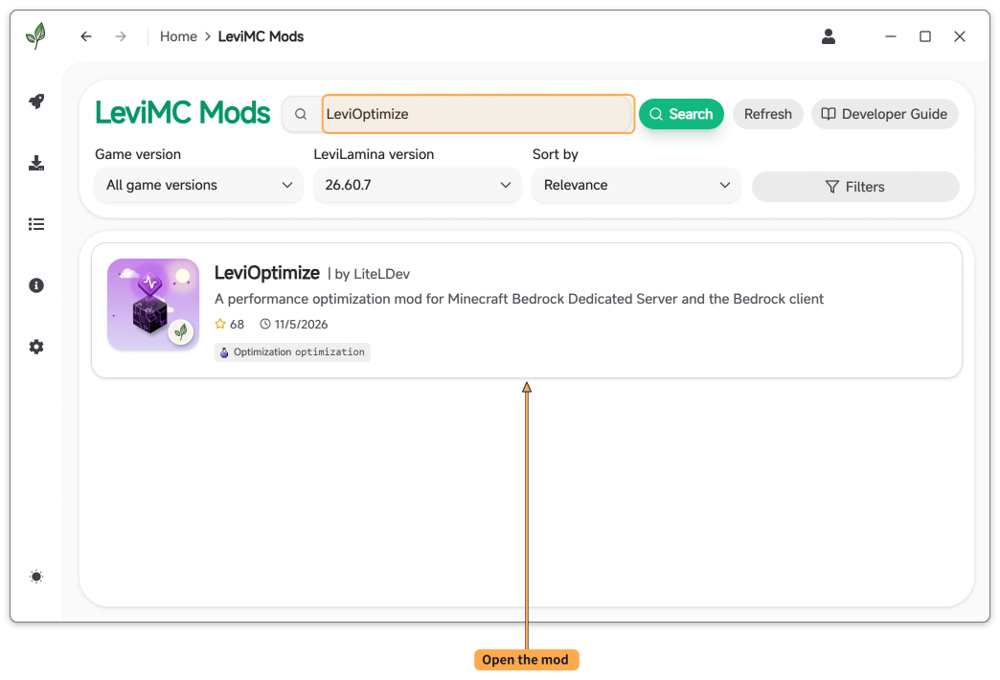

3. Press **Install**. LeviLauncher shows the **Versions** of the mod, with the `client` variant: the build for the game. Press **Install** on the newest version for your game version.

   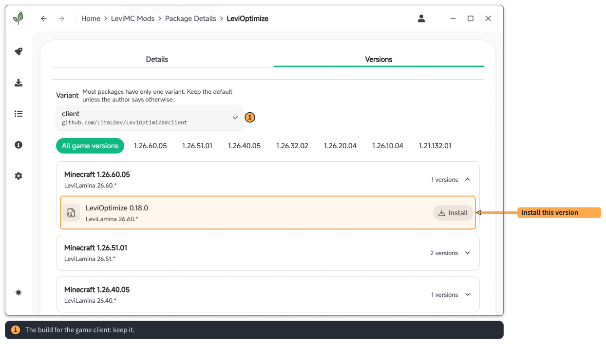

4. In **Select Target Instance**, check that your instance is selected, and press **Install**. LeviLauncher installs the mod with what it needs.

   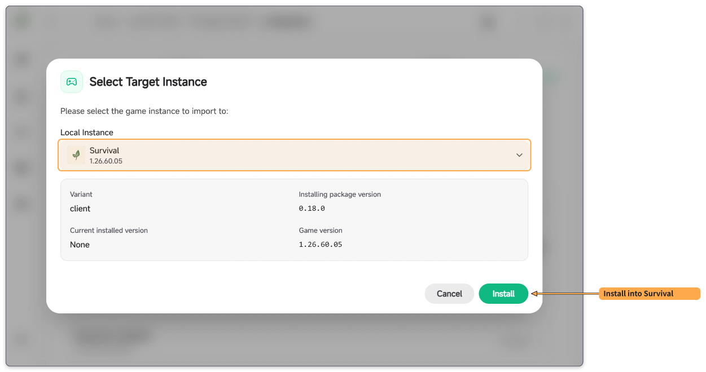

5. You should see "Installation completed successfully". Back on **Launch**, the **Mods** card of the instance lists LeviOptimize.

To add a mod you got as a file, use **Manage Mods** on the **Mods** card, then **Import .mcmod**. For a `.zip` or a bare `.dll`, choose **All files (\*.\*)** in the file picker.

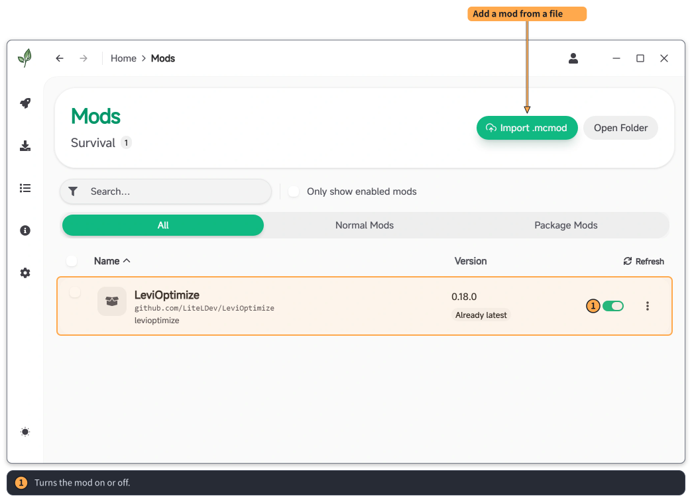

## 6. Play with the mod

1. On **Launch**, check the **Current Instance** and press **Launch**.
2. Minecraft starts with LeviLamina and LeviOptimize loaded. Open a world and play.

Add more mods one at a time, and launch after each one. If the game stops starting, turn off the newest mod first with its switch on the **Mods** page (**Manage Mods**).

::: tip Change LeviLamina later
To install, update or remove LeviLamina in an instance that already exists, press the gear button next to the instance picker on **Launch** (its quick actions), choose **Instance Settings**, and go to the **Loader** tab. For a game version that LeviLamina does not support, the tab says "LeviLamina is not supported for this game version".

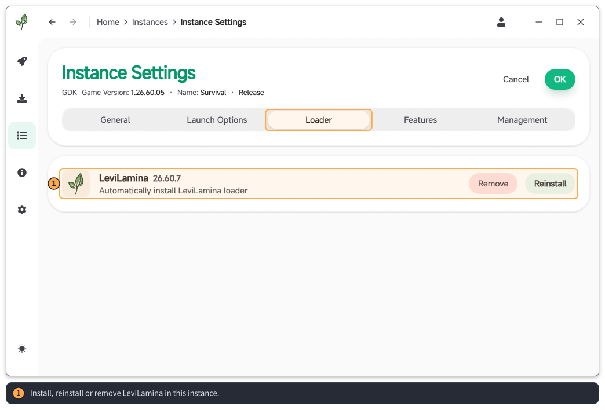
:::

## What you have now

- LeviLauncher, which installs and launches Minecraft versions.
- An isolated instance with LeviLamina and LeviOptimize, whose worlds and settings stay apart from your normal game.

## Next steps

- Join a server with mods, or run your own: [Your first server](../server/first-server.md).
- Everything the mods page of the launcher does, including CurseForge and the built-in package manager: [Mods & Integrations](https://levimc.org/LeviLauncher/guide/mods-integrations).
- Mirrors, the download list and local installers: [Downloads & Mirrors](https://levimc.org/LeviLauncher/guide/downloads-mirrors).
- Rename, delete and organize instances: [Version Management](https://levimc.org/LeviLauncher/guide/version-management).
- Worlds, resource packs and behavior packs: [Content Management](https://levimc.org/LeviLauncher/guide/content-management).
- When downloads fail or the game does not start: [Update & Troubleshooting](https://levimc.org/LeviLauncher/guide/update-troubleshooting).
- Play on your Android phone or tablet: [Play with mods on Android](./play-with-mods-android.md).
- Make a mod of your own: [Your first LeviLamina mod](../develop/first-levilamina-mod.md).
