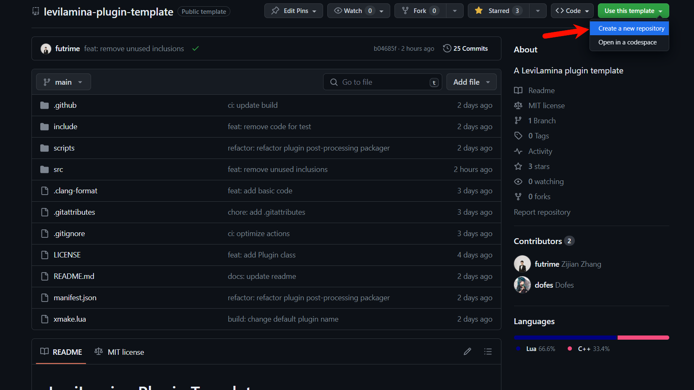

# 你的第一个 LeviLamina 模组

完成本教程后，你会拥有一个用 C++ 编写的 LeviLamina 模组：它的仓库由官方模组模板创建，在你的电脑上构建，并由你的服务器加载。模组启动时会在服务器控制台输出一行文字，还会添加一个 `/hello` 命令，向执行它的人打招呼。

第一次大约需要一小时，大部分时间花在安装工具和等待第一次构建下载 LeviLamina 上。

## 你需要准备

- 一台 Windows 10 或 11 电脑（x64）。模组使用 Windows 工具构建。
- C++ 基础。如果你刚开始学 C++，可以从 [cppreference.com](https://en.cppreference.com/) 和 [C++ Developer Roadmap](https://roadmap.sh/cpp) 入手。
- 一个 GitHub 账号，用来从模板创建仓库。
- 一个装有 LeviLamina 的服务器用于测试：见[开你的第一个服务器](../server/first-server.md)。本教程使用 `D:\servers\survival`。

## 1. 安装工具

按默认选项安装以下软件：

1. [Git](https://git-scm.com)。
2. [Visual Studio](https://visualstudio.microsoft.com/)（免费的 Community 版即可）。在安装程序中勾选工作负载 **使用 C++ 的桌面开发**：它会带来 Windows SDK 和 C++ 库。
3. [LLVM](https://github.com/llvm/llvm-project/releases/latest)，选择 `LLVM-<version>-win64.exe` 安装程序。安装时选择把 LLVM 加入 `PATH`。模板使用 LLVM 的 `clang-cl` 编译。
4. [xmake](https://xmake.io)，LeviLamina 模组的构建工具。
5. 可选，用于编辑代码：[Visual Studio Code](https://code.visualstudio.com)，以及扩展 [C/C++](https://marketplace.visualstudio.com/items?itemName=ms-vscode.cpptools)、[XMake](https://marketplace.visualstudio.com/items?itemName=tboox.xmake-vscode) 和 [clangd](https://marketplace.visualstudio.com/items?itemName=llvm-vs-code-extensions.vscode-clangd)。

打开一个**新的**终端，检查这些工具能否找到：

```powershell
git --version
clang-cl --version
xmake --version
```

你应该看到三个版本号。如果某个命令提示无法识别，请重新安装它并让它把自己加入 `PATH`，然后再打开一个新终端。

## 2. 从模板创建仓库

1. 打开 [LiteLDev/levilamina-mod-template](https://github.com/LiteLDev/levilamina-mod-template)，点击 **Use this template** → **Create a new repository**。给仓库起个名字，例如 `my-mod`；如果以后想发布，请设为公开（public）。

   

2. 把它克隆到存放项目的文件夹：

   ```powershell
   mkdir D:\projects
   cd D:\projects
   git clone https://github.com/<you>/my-mod
   cd my-mod
   ```

3. 你应该看到 `xmake.lua`、`lip.toml`、`manifest.json` 等文件，以及包含 `MyMod.cpp` 和 `MyMod.h` 的 `src\mod\` 文件夹。

## 3. 给模组命名

1. 打开 `xmake.lua`。`target` 就是模组的名字：LeviLamina 会显示它，模组的文件夹也以它命名。可以使用字母、数字和 `-`，不能有空格：

   ```lua
   target("my-mod") -- Change this to your mod name.
   ```

   本教程保留 `my-mod`。

2. 在同一个文件中，固定构建所用的 LeviLamina 版本。它的前两段版本号必须与服务器上的 LeviLamina 相同。要查看服务器的版本，在服务器文件夹中运行 `lip list`，它会显示一行类似 `github.com/LiteLDev/LeviLamina@26.60.3` 的内容。然后写：

   ```lua
   add_requires("levilamina 26.60.*", {configs = {target_type = get_config("target_type")}})
   ```

3. 修改 `LICENSE` 中的版权人，或者换成你想用的许可证。模板本身使用 CC0，你可以自由选择。

你也可以重命名 `src\mod\` 中的命名空间 `my_mod` 和类 `MyMod`，本教程不需要这样做。

## 4. 构建空模组

在写代码之前，先确认模板能构建。在仓库文件夹中运行：

```powershell
xmake f -y -p windows -a x64 -m release
xmake
```

第一条命令把构建配置为服务端模组（默认值；`--target_type=client` 构建客户端模组）。第一次运行时它会下载 LeviLamina 及其依赖，需要几分钟。第二条命令进行编译。

最后一行应该显示 `build ok`，并且出现文件夹 `bin\my-mod\`，里面有 `my-mod.dll` 和 `manifest.json`。

::: details 下载失败
xmake 从 GitHub 下载包。如果你的网络无法访问 GitHub，请为 xmake 配置 [GitHub 镜像代理](https://xmake.io/zh/guide/package-management/network-optimization.html#mirror-proxy)或 [HTTP 代理](https://xmake.io/zh/guide/package-management/network-optimization.html#proxy-setting)，然后重新运行这两条命令。如果 xmake 找不到你固定的 LeviLamina 版本，运行 `xmake repo -u` 更新包列表。
:::

## 5. 添加日志和命令

LeviLamina 会依次调用模组的三个阶段：`load()`、`enable()` 和 `disable()`。在 `load()` 中只做与游戏无关的工作，例如读取配置文件：这时游戏还没有准备好。命令注册和事件监听要从 `enable()` 开始。

命令要在游戏请求注册时注册，也就是 `ServerCommandRegisterEvent` 事件。把 `src\mod\MyMod.cpp` 的内容替换为：

```cpp
#include "mod/MyMod.h"

#include "ll/api/command/CommandHandle.h"
#include "ll/api/command/CommandRegistrar.h"
#include "ll/api/event/EventBus.h"
#include "ll/api/event/command/ServerCommandRegisterEvent.h"
#include "ll/api/mod/RegisterHelper.h"
#include "mc/server/commands/CommandOrigin.h"
#include "mc/server/commands/CommandOutput.h"
#include "mc/server/commands/CommandPermissionLevel.h"
#include "mc/world/actor/player/Player.h"

namespace my_mod {

MyMod& MyMod::getInstance() {
    static MyMod instance;
    return instance;
}

bool MyMod::load() {
    getSelf().getLogger().debug("Loading...");
    return true;
}

bool MyMod::enable() {
    getSelf().getLogger().info("Hello from my first mod!");

    using namespace ll::event;
    EventBus::getInstance().emplaceListener<ServerCommandRegisterEvent>([](ServerCommandRegisterEvent&) {
        auto& command = ll::command::CommandRegistrar::getInstance(false) // false：服务端命令
                            .getOrCreateCommand("hello", "Says hello.", CommandPermissionLevel::Any);
        command.overload().execute([](CommandOrigin const& origin, CommandOutput& output) {
            auto* entity = origin.getEntity();
            if (entity == nullptr || !entity->isPlayer()) {
                output.success("Hello, console!"); // 由控制台或命令方块执行
                return;
            }
            auto* player = static_cast<Player*>(entity); // 安全：上面已检查 isPlayer()
            output.success("Hello, {}!", player->getRealName());
        });
    });
    return true;
}

bool MyMod::disable() {
    getSelf().getLogger().debug("Disabling...");
    return true;
}

} // namespace my_mod

LL_REGISTER_MOD(my_mod::MyMod, my_mod::MyMod::getInstance());
```

这段代码做了什么：

- `getLogger().info(...)` 向服务器控制台输出一行，并标上模组的名字。
- `emplaceListener` 订阅一个事件。模组被禁用时，LeviLamina 会自动移除监听器。
- `getOrCreateCommand` 创建 `/hello`；`CommandPermissionLevel::Any` 允许所有玩家执行（`GameDirectors` 则只允许管理员）。
- `overload().execute(...)` 添加不带参数的 `/hello` 重载，以及执行时运行的代码。

::: warning 游戏类型没有 RTTI
Minecraft 编译时没有运行时类型信息，因此不能对它的类使用 `dynamic_cast`。请先检查类型（就像这里的 `isPlayer()`），再使用 `static_cast`。
:::

再次运行 `xmake` 构建。你应该再次看到 `build ok`。

## 6. 在服务器上加载模组

1. 如果服务器正在运行，先停止它。
2. 把 `bin\my-mod` 文件夹复制到服务器的 `mods` 文件夹，得到 `D:\servers\survival\mods\my-mod\my-mod.dll`：

   ```powershell
   Copy-Item -Recurse -Force bin\my-mod D:\servers\survival\mods\
   ```

3. 按[开你的第一个服务器](../server/first-server.md)中的方式启动服务器，或在服务器文件夹中运行 `lip run`。
4. 在 LeviLamina 加载模组的几行之后，你应该看到一行带有 `[my-mod]` 和 `Hello from my first mod!` 的输出。
5. 在服务器的输入行中输入 `hello`（控制台命令不带 `/`）。你应该看到 `Hello, console!`。
6. 从 Minecraft 加入服务器（地址 `127.0.0.1`，端口 `19132`），在聊天栏输入 `/hello`。你应该看到 `Hello, <你的名字>!`。

以后每次修改：停止服务器，运行 `xmake`，重新复制文件夹，启动服务器。

::: tip 模组没有加载时的错误码
如果 LeviLamina 没有加载 `my-mod`，而是报告 126 或 127 之类的错误，通常是因为模组所用的 LeviLamina 版本与服务器的不同。请检查第 3 步固定的版本。[LeviLamina 故障排除](https://levimc.org/zh-Hans/LeviLamina/user_guides/troubleshooting/)解释了这些错误码。
:::

## 你现在有了什么

- 一个存放模组的 Git 仓库，可以用 `xmake` 构建。
- 一个输出日志并注册命令的模组，已被你的服务器加载。
- `lip.toml` 和 `.github\workflows\` 中的发布工作流，可以随时发布。

## 下一步

- 让别人用一条命令安装你的模组：[用 lip 发布你的模组](publish-a-package.md)。
- 包含配置文件、数据库、表单和物品的更完整示例：[ShrBox/ExampleMod](https://github.com/ShrBox/ExampleMod)。
- 带参数的命令：[命令指南](https://levimc.org/zh-Hans/LeviLamina/developer_guides/how_to_guides/command_guide/)。
- 响应玩家的行为：[事件指南](https://levimc.org/zh-Hans/LeviLamina/developer_guides/how_to_guides/event_guide/)。
- 用对话框询问玩家：[表单指南](https://levimc.org/zh-Hans/LeviLamina/developer_guides/how_to_guides/form_guide/)。
- 改变游戏的行为：[Hook 指南](https://levimc.org/zh-Hans/LeviLamina/developer_guides/how_to_guides/hook_guide/)。
- 所有类和函数：[LeviLamina API](https://levimc.org/LeviLamina/api/)。
- 开发者常见问题：[开发者 FAQ](https://levimc.org/zh-Hans/LeviLamina/developer_guides/faq/)。
- 更想用脚本语言：[你的第一个脚本插件](first-script-plugin.md)。
