# 在 Windows 上玩模组

学完这篇教程，你会在 Windows 上玩到装有 LeviLamina 和一个模组的 Minecraft 基岩版。它运行在 LeviLauncher 的一个实例里，世界和设置与你平时玩的游戏互不干扰。游戏版本、LeviLamina 和模组都由 LeviLauncher 帮你安装：不需要 `lip`，也不需要别的东西。

## 你需要准备

- 64 位的 Windows 10 或 Windows 11。
- 在你登录的 Microsoft 账号上购买过 Minecraft 基岩版，并且至少在这台电脑上从 Microsoft Store 安装过一次。LeviLauncher 只是管理你的游戏，不能代替游戏授权。
- 网络连接。

## 1. 安装 LeviLauncher

1. 打开 [LeviLauncher 的最新发行版](https://github.com/LiteLDev/LeviLauncher/releases/latest)，下载 `LeviLauncher-amd64-installer.exe`。如果你那里访问 GitHub 很慢，可以用[蓝奏云镜像](https://levimc.lanzoue.com/b016ke39hc)，密码为 `levi`。
2. 运行安装程序，完成安装向导。如果它提示需要安装 WebView2 或其他组件，请允许它继续。
3. 启动 LeviLauncher。你应该看到它的窗口，左边有一列图标：**启动**、**下载**、**实例列表**、**关于**和**设置**（把鼠标指向图标就能看到名称）。第一次启动时，它打开的是**首次启动引导**。

## 2. 完成首次启动

1. 在**首次启动引导**里，**内容路径**下的**根目录**是 LeviLauncher 存放实例的位置。把它放在还有几 GB 空间的磁盘上：要更改，点**选择…**，选一个文件夹，再点**应用**。**语言**设置 LeviLauncher 的界面语言。

   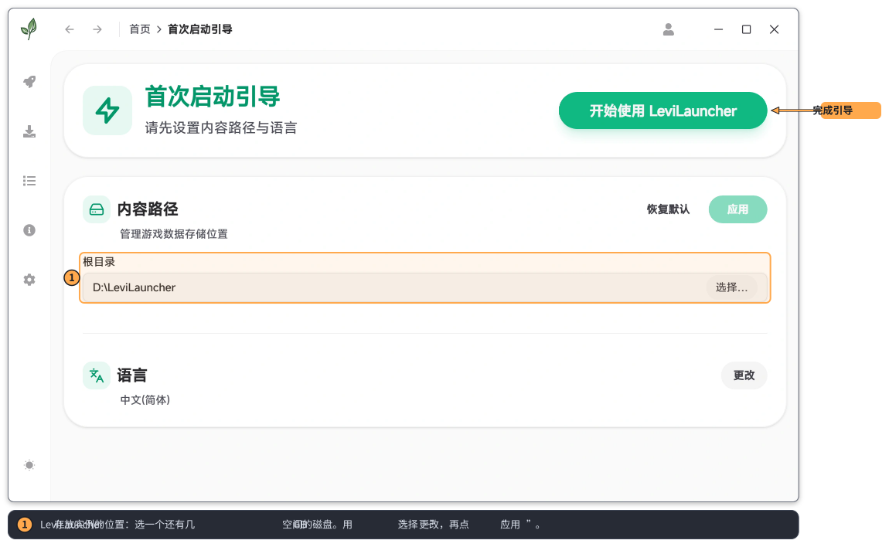

2. 点击**开始使用 LeviLauncher**。
3. LeviLauncher 会显示 **LeviLauncher 用户协议**。读完后，等按钮可以点击时点**同意并继续**。
4. LeviLauncher 会问**愿意帮助我们改进 LeviLauncher 吗？**，也就是是否允许它发送使用情况统计（Google Analytics）。选**同意并开启**或**暂不开启**都可以，以后可以在**设置**里更改。

看到**启动**页面，这一步就完成了。因为还没有实例，页面上的大按钮显示的是**下载 Minecraft**。

## 3. 安装一个带 LeviLamina 的游戏版本

1. 在侧边栏打开**下载**。
2. 你应该看到 Minecraft 正式版的 GDK 版本：**GDK**（包类型）和**类型**中的**正式版**都已经选好了。只有受支持的 GDK 版本才能自动安装 LeviLamina。
3. 找到**加载器**一栏显示 LeviLamina 的最新版本，点它的**下载**。游戏的最新版本常常在 LeviLamina 支持之前就发布了，所以它不一定在第一行。

   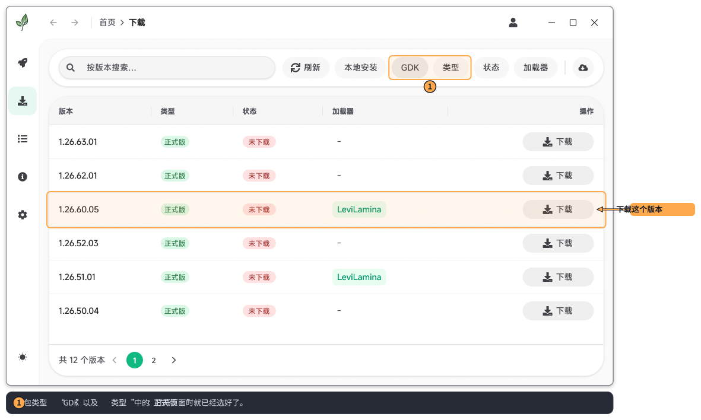

4. 在**选择下载镜像**里，LeviLauncher 会测试各个镜像并选中最快的那个。点击**用所选镜像下载**。

   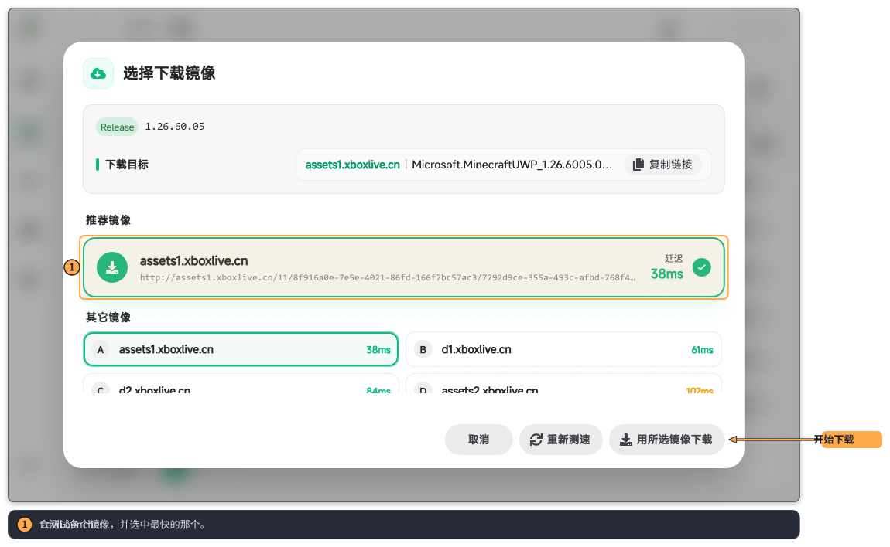

5. 等待下载完成，大约几 GB。完成后，你应该看到**下载完成**。点击**立即安装**。（之后这个版本那一行会显示**已下载**，它的**安装**按钮也能做同样的事。）

   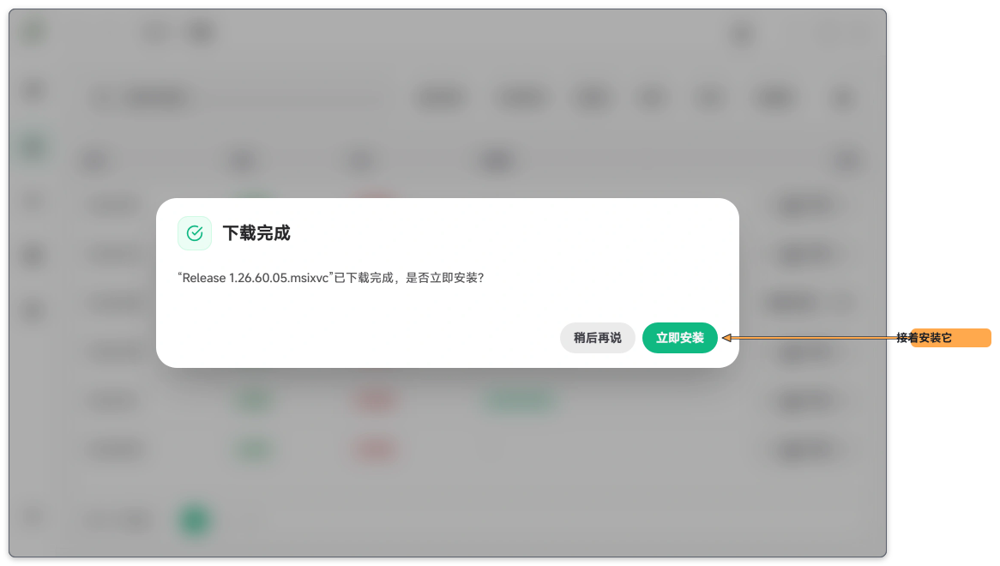

6. 在**安装实例**页面上：
   - 在**实例名称**里给实例起个名字，比如 `Survival`。
   - **安装 LeviLamina** 保持打开，**LeviLamina 版本**保持最新。
   - **实例隔离**保持打开，让这个实例把世界、设置和缓存保存在自己的文件夹里。

   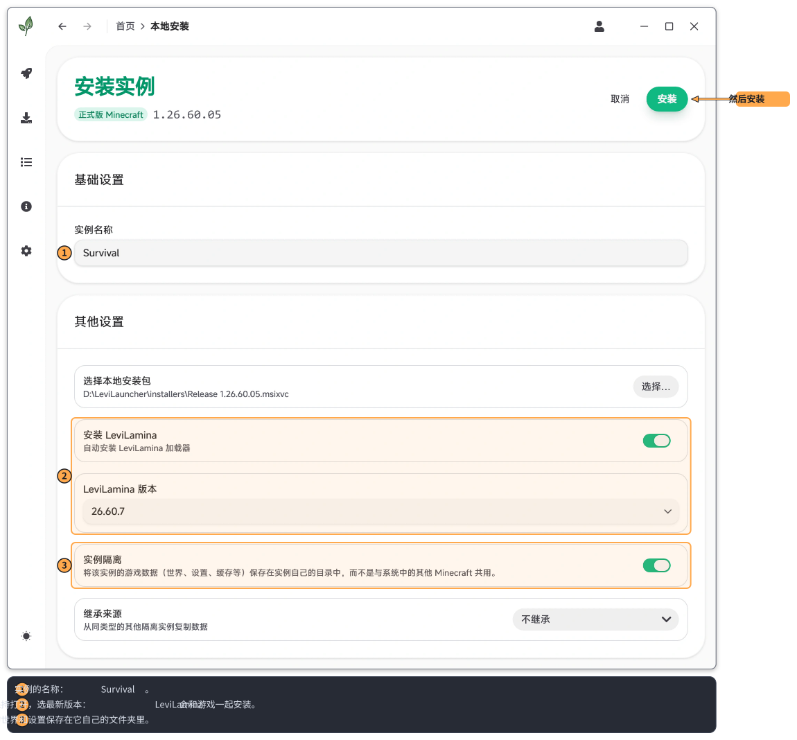

7. 点击页面顶部的**安装**，然后等待。你应该看到**安装完成**和“版本已成功安装”。点击**选择实例并前往启动**。

如果页面上没有**安装 LeviLamina**，说明 LeviLamina 不支持这个版本：回到**下载**，选一个**加载器**一栏显示 LeviLamina 的版本。

## 4. 启动游戏

1. 在**启动**页面上，**当前实例**应该就是你刚安装的实例，**Minecraft** 旁边有一个 LeviLamina 标记。如果不是，在实例选择器里选中它。

   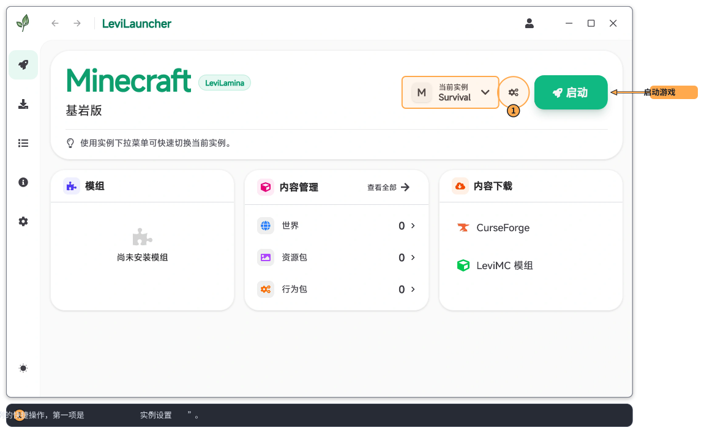

2. 点击**启动**。
3. 如果缺少游戏需要的组件，LeviLauncher 会提示：**缺少 GameInput 组件**、**缺少 Microsoft Gaming Services** 或**缺少 Visual C++ 运行库**。点击**立即安装**（Gaming Services 是**打开商店进行安装**），按安装程序的提示完成，然后再点**启动**。

   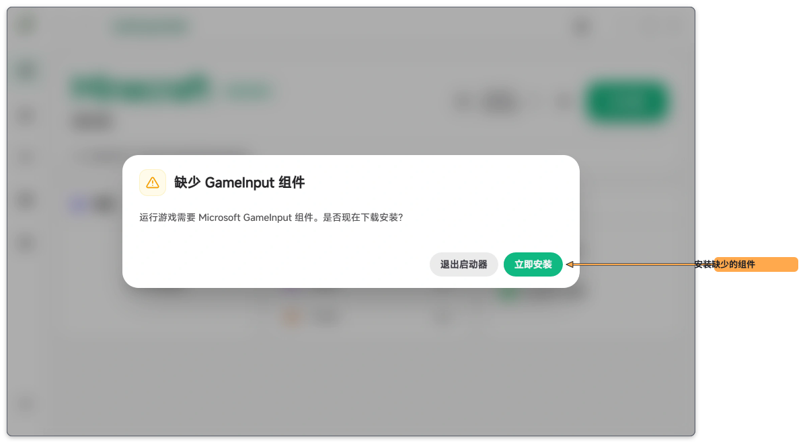

4. Minecraft 启动了。看到标题画面后就关掉它：下一步要添加模组。

如果 LeviLauncher 提示“当前账户没有此版本的授权。”，说明它使用的 Microsoft 账户没有购买 Minecraft。点击右上角的人像图标（**登录微软账户**；已经登录了账户时是**切换账户**），登录购买了游戏的账户，然后再启动。

这次不带模组的启动说明实例本身没问题。之后如果出了问题，你就知道是模组造成的。

## 5. 安装模组

1. 在**启动**页面上，**内容下载**卡片可以进入 **LeviMC 模组**。打开它。这里列出的是 [LeviMC 模组](https://levimc.org/zh-Hans/mods/)中带有 Windows 客户端构建、适用于你实例中 LeviLamina 的模组。
2. 在**搜索模组…**里输入 `LeviOptimize`，然后打开 LeviOptimize。

   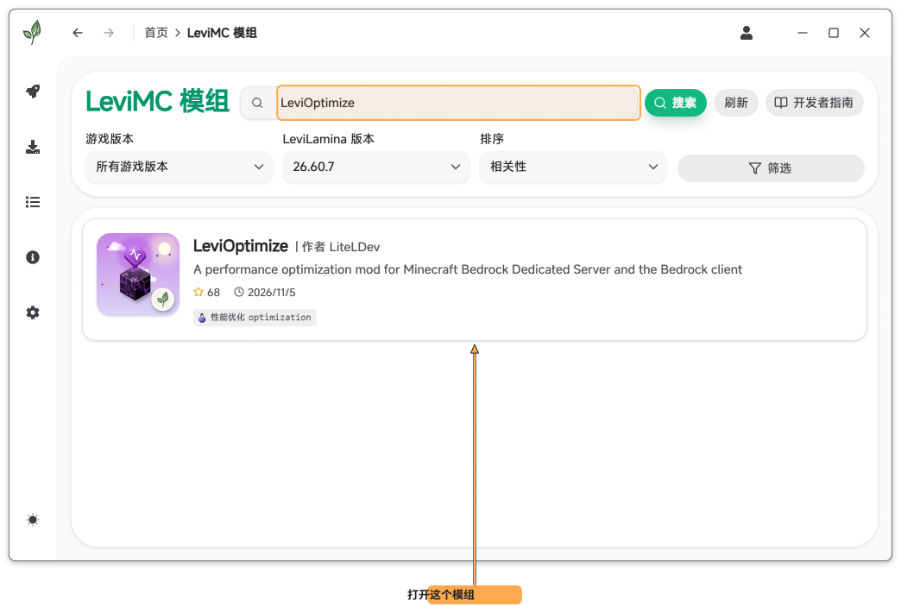

3. 点击**安装**。LeviLauncher 会显示模组的**版本**，变体为 `client`，也就是游戏客户端用的构建。在适用于你的游戏版本的最新版本上点击**安装**。

   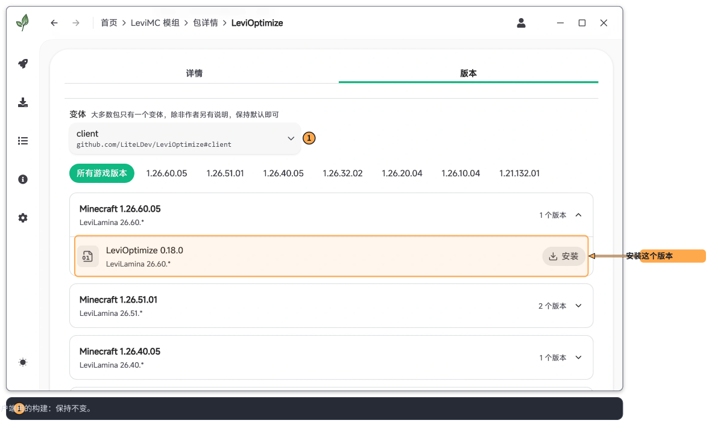

4. 在**选择目标实例**里确认选中的是你的实例，然后点击**安装**。LeviLauncher 会安装模组和它需要的依赖。

   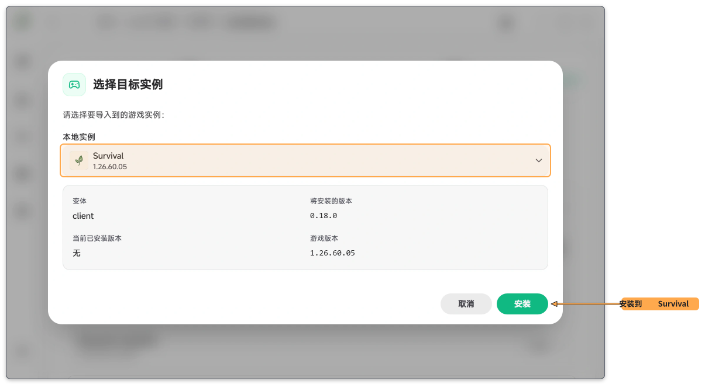

5. 你应该看到“安装成功”。回到**启动**页面，实例的**模组**卡片里列出了 LeviOptimize。

要添加以文件形式拿到的模组，在**模组**卡片上点**管理模组**，再点**导入 .mcmod**。如果是 `.zip` 或单独的 `.dll`，在文件选择框里选择**所有文件 (\*.\*)**。

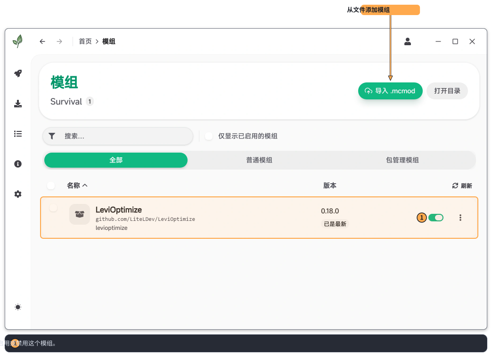

## 6. 带着模组游玩

1. 在**启动**页面确认**当前实例**，点击**启动**。
2. Minecraft 启动时会加载 LeviLamina 和 LeviOptimize。打开一个世界开始玩吧。

以后每次只添加一个模组，加完就启动一次。如果游戏启动不了，先在**模组**页面（**管理模组**）里用开关禁用最新加的那个模组。

::: tip 以后更改 LeviLamina
要在已有的实例里安装、更新或移除 LeviLamina，在**启动**页面点击实例选择器旁边的齿轮按钮（实例的快捷操作），选择**实例设置**，进入**加载器**标签页。如果 LeviLamina 不支持这个游戏版本，标签页里会显示“该游戏版本不支持 LeviLamina”。

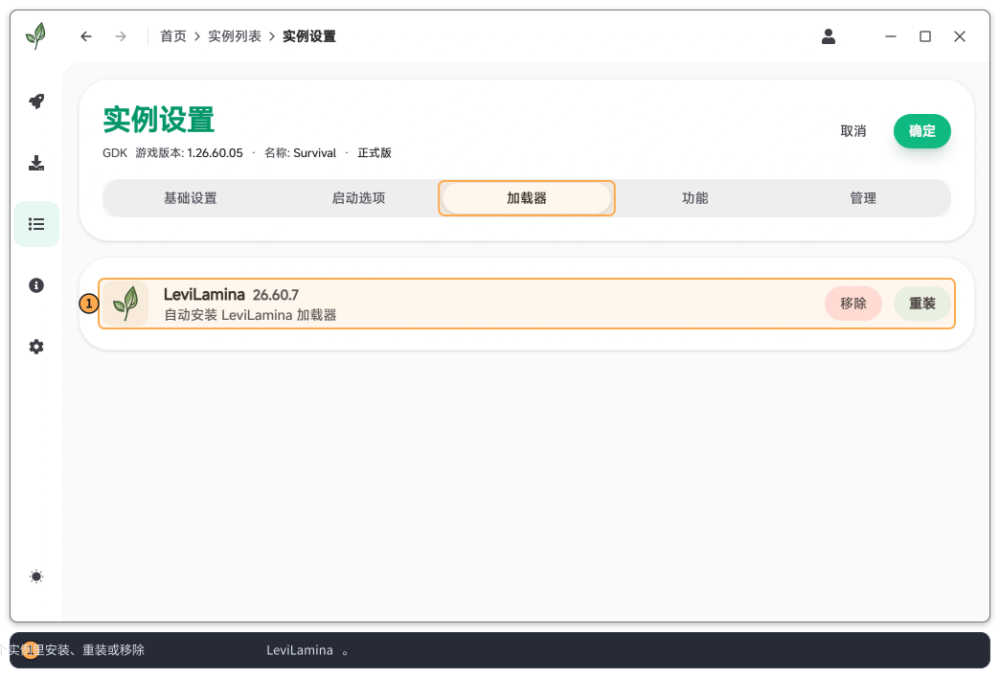
:::

## 你现在有了什么

- LeviLauncher，它负责安装和启动 Minecraft 的各个版本。
- 一个隔离的实例，装有 LeviLamina 和 LeviOptimize，世界和设置与你平时玩的游戏互不干扰。

## 下一步

- 加入一个带模组的服务器，或者自己开一个：[开你的第一个服务器](../server/first-server.md)。
- 启动器模组功能的全部内容，包括 CurseForge 和内置的包管理器：[模组与集成](https://levimc.org/zh-Hans/LeviLauncher/guide/mods-integrations)。
- 镜像、下载列表和本地安装包：[下载与镜像](https://levimc.org/zh-Hans/LeviLauncher/guide/downloads-mirrors)。
- 重命名、删除和整理实例：[版本管理](https://levimc.org/zh-Hans/LeviLauncher/guide/version-management)。
- 世界、资源包和行为包：[内容管理](https://levimc.org/zh-Hans/LeviLauncher/guide/content-management)。
- 下载失败或游戏启动不了时：[更新与故障排查](https://levimc.org/zh-Hans/LeviLauncher/guide/update-troubleshooting)。
- 在 Android 手机或平板上玩：[在 Android 上玩模组](./play-with-mods-android.md)。
- 自己做一个模组：[你的第一个 LeviLamina 模组](../develop/first-levilamina-mod.md)。
